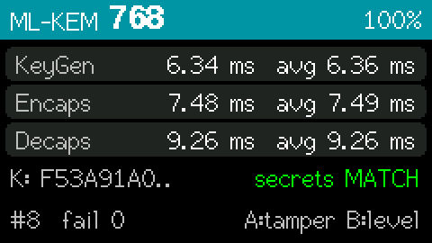

# fips203-mlkem-esp32

Post-quantum key encapsulation for ESP32 using **ML-KEM** (FIPS 203), formerly known as CRYSTALS-Kyber. Supports all three NIST security levels: **ML-KEM-512**, **ML-KEM-768**, and **ML-KEM-1024**, in one library build.

Ported from the [mlkem-native](https://github.com/pq-code-package/mlkem-native) implementation (PQCP project) with ESP32 hardware RNG support and a configuration tuned for microcontrollers. It is the key-exchange companion of [fips204-mldsa-esp32](https://github.com/ANONYMIZED-FOR-REVIEW/fips204-mldsa-esp32) (ML-DSA signatures) and follows the same structure and API style.

## Features

- **FIPS 203 compliant**: all three ML-KEM parameter sets (512, 768, 1024), available side by side
- **Verified against NIST ACVP vectors**: on the device and on the host (AddressSanitizer/UBSan)
- **Hardware RNG**: uses the ESP32's random number generator (`esp_fill_random`)
- **Tiny stack footprint**: under 2 KB of stack for every operation, so it runs directly from `setup()`/`loop()` without a dedicated FreeRTOS task
- **Fast**: a full ML-KEM-768 key exchange takes about 23 ms on a 240 MHz ESP32
- **Constant-time**: secret-independent control flow and memory access, value barriers, zeroization of all secret intermediates
- **FIPS 203 input validation**: public key modulus check and secret key hash check
- **NVS key storage**: persist keypairs in flash, as a full keypair or as a compact 64-byte seed
- **Arduino-friendly**: simple C++ wrapper classes (`MLKEM512`, `MLKEM768`, `MLKEM1024`)
- **No symbol clashes**: the RNG hook is namespaced, so the library can be linked together with libsodium (part of the ESP32 core) and with fips204-mldsa-esp32

## About ML-KEM

ML-KEM (Module-Lattice-Based Key-Encapsulation Mechanism) is the post-quantum key establishment scheme standardized by NIST as **FIPS 203** in August 2024. It is derived from the **CRYSTALS-Kyber** submission to the NIST Post-Quantum Cryptography competition.

### How it works

A KEM lets two parties agree on a shared secret over an insecure channel:

1. **Alice** generates a keypair and publishes her *encapsulation key* (public key).
2. **Bob** runs *Encaps* on Alice's public key. This yields a random 32-byte **shared secret** and a **ciphertext** that he sends to Alice.
3. **Alice** runs *Decaps* on the ciphertext with her *decapsulation key* (secret key) and recovers the same shared secret.

Both sides then use the shared secret as a symmetric key, for example with AES-256-GCM or ChaCha20-Poly1305, or feed it into a KDF such as HKDF.

ML-KEM is built on the hardness of the **Module Learning With Errors (MLWE)** problem over the ring $\mathbb{Z}_q[X]/(X^{256}+1)$ with $q = 3329$. No efficient quantum algorithm is known for it, unlike RSA and elliptic-curve Diffie-Hellman, which Shor's algorithm breaks. Polynomial multiplication uses the **Number Theoretic Transform (NTT)**, which keeps the scheme fast even on small microcontrollers.

A Fujisaki-Okamoto transform makes the scheme **IND-CCA2 secure**. Decapsulation re-encrypts the recovered message and compares the result with the received ciphertext. If a ciphertext was modified, decapsulation does **not** report an error. It returns a pseudo-random secret derived from a hidden value *z* (**implicit rejection**), and the parties' secrets simply do not match.

### Benefits

- **Quantum-resistant**: security relies on lattice problems with no known efficient quantum attack.
- **Fast**: keygen, encapsulation, and decapsulation each take only milliseconds on an ESP32.
- **Compact**: ML-KEM-768 has a 1,184-byte public key and a 1,088-byte ciphertext.
- **Deterministic key derivation**: a keypair can be re-derived from a 64-byte seed, which allows compact key storage and backup.
- **Standardized**: FIPS 203 ensures interoperability, for example with the hybrid `X25519MLKEM768` key exchange used in TLS 1.3.

### Parameter set comparison

| Variant | Security level | Public key | Secret key | Ciphertext | Shared secret |
|---------|---------------|-----------|-----------|-----------|---------------|
| ML-KEM-512 | NIST Category 1 (~AES-128) | 800 B | 1,632 B | 768 B | 32 B |
| ML-KEM-768 | NIST Category 3 (~AES-192) | 1,184 B | 2,400 B | 1,088 B | 32 B |
| ML-KEM-1024 | NIST Category 5 (~AES-256) | 1,568 B | 3,168 B | 1,568 B | 32 B |

**ML-KEM-768** is NIST's recommended default and is used in the examples. All three levels fit comfortably on any ESP32.

## Requirements

- An ESP32-family board (ESP32, ESP32-S2, ESP32-S3, ESP32-C3, ESP32-C6, ...)
- Arduino-ESP32 core 3.x (recommended) or 2.0.x, via the Arduino IDE, `arduino-cli`, or PlatformIO
- About 2 KB of stack plus 6-21 KB of temporary heap per operation (see [Memory usage](#memory-usage))
- About 11 KB of flash for one parameter set, or 19 KB for all three

## Installation

### Arduino IDE

1. Download or clone this repository.
2. Copy the `fips203-mlkem-esp32` folder into your Arduino libraries directory:
   - Linux: `~/Arduino/libraries/`
   - macOS: `~/Documents/Arduino/libraries/`
   - Windows: `Documents\Arduino\libraries\`
3. Restart the Arduino IDE. The examples appear under *File → Examples → fips203-mlkem-esp32*.

### arduino-cli

```bash
arduino-cli compile -b esp32:esp32:m5stack_stickc_plus2 --library /path/to/fips203-mlkem-esp32 \
    /path/to/fips203-mlkem-esp32/examples/mlkem_simple
arduino-cli upload  -b esp32:esp32:m5stack_stickc_plus2 -p /dev/ttyACM0 \
    /path/to/fips203-mlkem-esp32/examples/mlkem_simple
```

### PlatformIO

Add to your `platformio.ini`:

```ini
lib_deps =
    symlink:///path/to/fips203-mlkem-esp32      ; or the git URL of this repository
```

## Quick Start

All three variants share the same API. Include `MLKEM.h`, or the header of a specific level, and use the corresponding class:

```cpp
#include <Arduino.h>
#include <MLKEM768.h>  // or <MLKEM512.h> / <MLKEM1024.h> / <MLKEM.h> (all)

static uint8_t pk[MLKEM768::PUBLIC_KEY_SIZE];
static uint8_t sk[MLKEM768::SECRET_KEY_SIZE];
static uint8_t ct[MLKEM768::CIPHERTEXT_SIZE];
static uint8_t ssBob[MLKEM768::SHARED_SECRET_SIZE];
static uint8_t ssAlice[MLKEM768::SHARED_SECRET_SIZE];

void setup() {
  Serial.begin(115200);

  MLKEM768::generateKeypair(pk, sk);        // Alice: publish pk
  MLKEM768::encapsulate(ct, ssBob, pk);     // Bob:   send ct to Alice
  MLKEM768::decapsulate(ssAlice, ct, sk);   // Alice

  // ssAlice == ssBob: a 32-byte shared secret for AES-256-GCM, HKDF, ...
  Serial.println(memcmp(ssAlice, ssBob, 32) == 0 ? "match" : "differ");

  memset(sk, 0, sizeof(sk));                // zeroize secrets after use
}

void loop() {}
```

No FreeRTOS task is needed. The library uses under 2 KB of stack, and the static buffers keep the keys off the 8 KB `loop()` stack.

## API Reference

### Core operations (MLKEM512 / MLKEM768 / MLKEM1024)

`MLKEM512`, `MLKEM768`, and `MLKEM1024` are aliases of the class template `MLKEM<512>`, `MLKEM<768>`, and `MLKEM<1024>`, so generic code can be written as `template <class KEM> ...`.

```cpp
#include <MLKEM.h>

// Generate a random keypair (hardware RNG)
int MLKEMxx::generateKeypair(uint8_t *pk, uint8_t *sk);

// Derive a keypair from a 64-byte seed d || z (FIPS 203 ML-KEM.KeyGen_internal)
int MLKEMxx::generateKeypairFromSeed(uint8_t *pk, uint8_t *sk, const uint8_t *seed);

// Encapsulate: new shared secret ss + ciphertext ct for the owner of pk
int MLKEMxx::encapsulate(uint8_t *ct, uint8_t *ss, const uint8_t *pk);

// Deterministic encapsulation with a 32-byte m (testing only)
int MLKEMxx::encapsulateFromSeed(uint8_t *ct, uint8_t *ss, const uint8_t *pk, const uint8_t *seed);

// Decapsulate: recover ss from ct with the secret key
int MLKEMxx::decapsulate(uint8_t *ss, const uint8_t *ct, const uint8_t *sk);

// FIPS 203 input validation (also done inside encapsulate/decapsulate)
int MLKEMxx::checkPublicKey(const uint8_t *pk);   // Section 7.2, modulus check
int MLKEMxx::checkSecretKey(const uint8_t *sk);   // Section 7.3, hash check
```

Constants: `PUBLIC_KEY_SIZE`, `SECRET_KEY_SIZE`, `CIPHERTEXT_SIZE`, `SHARED_SECRET_SIZE` (32), `KEYPAIR_SEED_SIZE` (64), `ENCAPS_SEED_SIZE` (32), `PARAMETER_SET` (512/768/1024), `SECURITY_CATEGORY` (1/3/5).

All functions return `0` on success and a negative error code on failure:

| Code | Meaning |
|------|---------|
| `MLK_ERR_INVALID_PK` (-4) | public key failed the modulus check |
| `MLK_ERR_INVALID_SK` (-5) | secret key failed the hash check (corrupted) |
| `MLK_ERR_OUT_OF_MEMORY` (-2) | heap allocation of temporaries failed |
| `MLK_ERR_RNG_FAIL` (-3) | random number generator failure |

> A **tampered ciphertext is not an error**. `decapsulate()` returns 0 together with an unrelated pseudo-random secret (implicit rejection), so the mismatch only shows up when the secret is used, for example when AEAD decryption fails.

### C API

`#include <mlkem_esp32.h>` declares the mlkem-native C API for all three levels:

```c
int PQCP_MLKEM_NATIVE_MLKEM768_keypair(uint8_t *pk, uint8_t *sk);
int PQCP_MLKEM_NATIVE_MLKEM768_keypair_derand(uint8_t *pk, uint8_t *sk, const uint8_t coins[64]);
int PQCP_MLKEM_NATIVE_MLKEM768_enc(uint8_t *ct, uint8_t *ss, const uint8_t *pk);
int PQCP_MLKEM_NATIVE_MLKEM768_enc_derand(uint8_t *ct, uint8_t *ss, const uint8_t *pk, const uint8_t coins[32]);
int PQCP_MLKEM_NATIVE_MLKEM768_dec(uint8_t *ss, const uint8_t *ct, const uint8_t *sk);
int PQCP_MLKEM_NATIVE_MLKEM768_check_pk(const uint8_t *pk);
int PQCP_MLKEM_NATIVE_MLKEM768_check_sk(const uint8_t *sk);
/* ... and the same for MLKEM512 and MLKEM1024 */

int mlkem_esp32_randombytes(uint8_t *out, size_t outlen);  /* the RNG used above */
```

Size constants: `MLKEM{512,768,1024}_{PUBLICKEYBYTES,SECRETKEYBYTES,CIPHERTEXTBYTES}`, `MLKEM_BYTES`, `MLKEM_SYMBYTES`.

### MLKEM_NVS (persistent key storage)

```cpp
#include <MLKEM_NVS.h>

// MLKEM512_NVS / MLKEM768_NVS / MLKEM1024_NVS  (= MLKEM_NVS<MLKEMxxx>)
bool MLKEM768_NVS::saveKeypair(const char *ns, const uint8_t *pk, const uint8_t *sk);
bool MLKEM768_NVS::saveSeed(const char *ns, const uint8_t *seed);          // 64 bytes
bool MLKEM768_NVS::loadKeypair(const char *ns, uint8_t *pk, uint8_t *sk);  // either format
bool MLKEM768_NVS::loadPublicKey(const char *ns, uint8_t *pk, uint8_t *sk_scratch = nullptr);
bool MLKEM768_NVS::hasKeypair(const char *ns);
bool MLKEM768_NVS::eraseKeypair(const char *ns);

// Generate + save in one step; seedOnly = true stores just the 64-byte seed
int  MLKEM768_NVS::generateAndSave(const char *ns, uint8_t *pk, uint8_t *sk,
                                   bool seedOnly = false);
```

`ns` is an NVS namespace (at most 15 characters). The parameter set is stored with the key, so a key saved as ML-KEM-512 is never loaded as ML-KEM-768. `loadKeypair()` validates the secret key with the FIPS 203 hash check and fails on corrupted data.

**Seed storage is recommended.** It uses 64 bytes of flash instead of 3.5 KB, and on the ESP32 re-deriving the keypair (7.8 ms) is even faster than reading and validating the full keypair from NVS (9.0 ms).

## Examples

| Example | Description |
|---------|-------------|
| [mlkem_simple](examples/mlkem_simple/) | Minimal ML-KEM-768 key exchange using the `MLKEM768` wrapper |
| [mlkem_demo_arduino](examples/mlkem_demo_arduino/) | C API demo with timing, memory diagnostics, tamper test (implicit rejection), and invalid key tests |
| [mlkem_nvs_storage](examples/mlkem_nvs_storage/) | Persistent key storage in NVS flash (survives reboots); send `e` to erase |
| [mlkem_test_vectors](examples/mlkem_test_vectors/) | FIPS 203 conformance test against NIST ACVP vectors, all three levels |
| [mlkem_benchmark](examples/mlkem_benchmark/) | Timing (min/median/mean/max), peak stack and heap per operation, CSV output |
| [m5stickc-plus2](examples/m5stickc-plus2/) | Live key-exchange dashboard for the M5StickC PLUS2 display (requires M5Unified) |



*`m5stickc-plus2` example: framebuffer captured from the device. Button A runs a tamper test, button B switches the parameter set.*

## Performance

Measured with `examples/mlkem_benchmark` (100 iterations per operation) on an **M5StickC PLUS2** (ESP32-PICO-V3-02 @ 240 MHz, Arduino-ESP32 3.3.11 / ESP-IDF 5.5.5, default `-Os`, default heap mode):

| Operation | ML-KEM-512 | ML-KEM-768 | ML-KEM-1024 |
|-----------|-----------|-----------|------------|
| KeyGen | 3.80 ms | 6.15 ms | 9.51 ms |
| Encaps | 4.67 ms | 7.41 ms | 11.00 ms |
| Decaps | 5.96 ms | 9.17 ms | 13.24 ms |
| **Full exchange** | **14.4 ms** | **22.7 ms** | **33.8 ms** |

(median of 100 runs. Min-max spread: Decaps < 0.5%, Encaps < 2%. KeyGen varies by up to 8%, because the public matrix is rejection-sampled from a fresh random seed each time. That variation depends only on public data.)

## Memory usage

Peak memory per operation, measured on the device:

| Operation | ML-KEM-512 | ML-KEM-768 | ML-KEM-1024 |
|-----------|-----------|-----------|------------|
| KeyGen, stack / heap | 1.8 KB / 5.8 KB | 1.5 KB / 10.1 KB | 1.5 KB / 15.3 KB |
| Encaps, stack / heap | 1.6 KB / 8.6 KB | 1.5 KB / 13.1 KB | 1.5 KB / 18.9 KB |
| Decaps, stack / heap | 1.8 KB / 9.1 KB | 1.5 KB / 14.2 KB | 1.5 KB / 20.4 KB |

(1 KB = 1024 bytes. The heap figures include the allocator's block headers.)

By default, large temporaries (the public matrix, polynomial vectors, and so on) are allocated from **internal** RAM (never PSRAM, so secrets stay on-chip). They are zeroized before being freed and released before the call returns. This keeps the stack requirement below 2 KB for every level, at a cost of about 3% run time.

**Stack mode.** Build with `-DMLKEM_ESP32_USE_STACK` (PlatformIO: `build_flags = -DMLKEM_ESP32_USE_STACK`) to place the temporaries on the stack instead. That is about 2-3% faster and needs no heap, but the calling task must provide:

| | ML-KEM-512 | ML-KEM-768 | ML-KEM-1024 |
|-|-----------|-----------|------------|
| Peak stack (stack mode) | 10.5 KB | 15.6 KB | 21.8 KB |
| Recommended task stack | 16 KB | 24 KB | 32 KB |

In stack mode, run ML-KEM in a FreeRTOS task with a sufficient stack. The default Arduino `loop()` stack (8 KB) is too small:

```cpp
xTaskCreate(cryptoTask, "mlkem", 32 * 1024, NULL, 1, NULL);
```

## Conformance testing

- `examples/mlkem_test_vectors` checks, for each level on the device, 25 keyGen, 5 encapsulation, 5 decapsulation (including implicit-rejection cases), and 8 key-check vectors from the official **NIST ACVP** server, plus 20 randomized round trips with tamper tests (249 checks). Result on the M5StickC PLUS2: **249 passed, 0 failed**.
- To embed the complete ACVP set (540 checks including the randomized ones on the host, 360 on the device), regenerate the header:
  `scripts/gen_acvp_vectors.py --download --all --out examples/mlkem_test_vectors/acvp_vectors.h`.
  The full set also passes on the device and on the host, in both heap and stack mode, under AddressSanitizer and UndefinedBehaviorSanitizer.
- `examples/mlkem_benchmark` checks every one of its 900 operations for matching shared secrets.

## Important Notes

- **Entropy**: `esp_fill_random()` produces true random numbers only while an entropy source is running: **Wi-Fi or Bluetooth enabled**, or `bootloader_random_enable()` active. With all of them off, the ESP-IDF documentation says the RNG output should be considered pseudo-random. For production key generation, bring up Wi-Fi/BT first (or use a seed that was provisioned securely).
- **Use the shared secret, not the ciphertext**: the ciphertext is public. Derive session keys from the 32-byte shared secret, for example with HKDF, and bind them to your protocol transcript.
- **Authentication is not included**: a KEM alone does not authenticate the peer. Combine it with signatures (for example [fips204-mldsa-esp32](https://github.com/ANONYMIZED-FOR-REVIEW/fips204-mldsa-esp32)) or pre-shared public keys to stop man-in-the-middle attacks. Consider hybrid X25519 + ML-KEM during the transition period.
- **Secret key handling**: zeroize secret keys and shared secrets after use (`memset` or `mbedtls_platform_zeroize`). Keys in NVS are stored in plain text unless NVS/flash encryption is enabled.
- **Reuse of keys**: an ML-KEM keypair may be used for many encapsulations (IND-CCA2). Never reuse the `m` passed to `encapsulateFromSeed()`, since that reproduces the same shared secret.

## Port details

Upstream: mlkem-native `main` (snapshot of 2026-09-10, after v2.0.0), portable C backend only (the ESP32 has no NTT/Keccak SIMD backend). The upstream sources in `src/` are unmodified. The port consists of:

| File | Purpose |
|------|---------|
| `src/mlkem_native_config.h` | Upstream config plus ESP32 settings: multi-level build (ML-KEM-512 carries the shared code), namespaced RNG, `MLK_CONFIG_SERIAL_FIPS202_ONLY` (batched Keccak is only ~1.5% faster here but needs 2 KB more stack), internal-RAM heap allocator |
| `src/mlkem768_build.c`, `src/mlkem1024_build.c` | Recompile the level-dependent units (`indcpa.c`, `kem.c`, `poly_k.c`) for 768 and 1024 |
| `src/randombytes.c` | `mlkem_esp32_randombytes()` → `esp_fill_random()` |
| `src/mlkem_esp32.h` | C declarations of all three levels |
| `src/MLKEM.h`, `MLKEM512/768/1024.h`, `MLKEM_NVS.h` | C++ wrappers |
| `scripts/gen_acvp_vectors.py` | Converts NIST ACVP JSON into `acvp_vectors.h` |
| `scripts/update_mlkem_native.sh` | Re-vendors a newer mlkem-native into `src/` |

Compiler note: on the ESP32, code built with `-Os` (the Arduino default) takes about 30% **less** time than with `-O2` (ML-KEM-768 KeyGen: 6.0 ms vs 8.6 ms), most likely because the smaller code fits better in the flash cache. No optimization override is applied.

Tested on hardware: M5StickC PLUS2 (ESP32-PICO-V3-02), with Arduino-ESP32 3.3.11 (arduino-cli) and with Arduino-ESP32 2.0.17 (PlatformIO `espressif32` 7.1.3; about 10% slower there because of the older compiler). All examples are compile-tested on ESP32, ESP32-S2, ESP32-S3, ESP32-C3, and ESP32-C6 (Arduino-ESP32 3.3.11).

## License

Licensed under the **Apache License, Version 2.0**.

The cryptographic implementation is derived from [mlkem-native](https://github.com/pq-code-package/mlkem-native) (PQCP project), which is licensed under Apache-2.0 OR ISC OR MIT (see `src/LICENSE.mlkem-native`). The upstream source files keep their original license headers. The ACVP test vectors come from NIST.

## Links

- [FIPS 203 Standard](https://csrc.nist.gov/pubs/fips/203/final)
- [mlkem-native (upstream)](https://github.com/pq-code-package/mlkem-native)
- [NIST ACVP Server (test vectors)](https://github.com/usnistgov/ACVP-Server)
- [fips204-mldsa-esp32 (ML-DSA signatures)](https://github.com/ANONYMIZED-FOR-REVIEW/fips204-mldsa-esp32)
